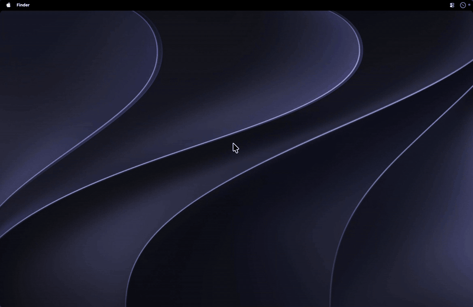

# NotchBlack: hide the MacBook notch on macOS 27

**A free, open-source TopNotch alternative for macOS 27 Golden Gate.** NotchBlack turns the menu bar black so the notch disappears into the bezel, and can hide app menus and menu bar icons until you hover.

It also works as a lightweight replacement for menu bar managers like Bartender, Ice and Thaw, many of which stopped working when macOS 27 changed how the menu bar is drawn.



## Features

- **Black menu bar.** The notch blends into a solid black strip across the top of the screen.
- **Rounded corners.** Black rounded corners just below the menu bar, in Small, Medium or Large.
- **Hide App Menus.** Covers File, Edit, View and the rest of the app menus while keeping the Apple logo and the app name visible. Hover the menu bar to the left of the notch and they fade back in.
- **Hide Menu Bar Icons.** Covers the status icons to the right of the notch, keeping only Control Center and the clock. Hover to the right of the notch to show them. This can replace a menu bar manager like Bartender, Ice or Thaw.
- **Launch at Login**, from the app's own menu.

Every overlay lets clicks through, so menus and icons still work while they're hidden. Keyboard shortcuts and Ctrl+F2 are unaffected.

## Requirements

- A MacBook with a notch
- Apple silicon
- Tested on macOS 27 (Golden Gate). It should also work on macOS 13 and later, but older versions haven't been tested.
- Apple's command line tools, to build it. If you don't have them, run `xcode-select --install` once.

## Install

```sh
git clone https://github.com/dmtrsfr/NotchBlack.git
cd NotchBlack
./install.sh
```

This builds the app, copies it to `/Applications` and opens it. A new icon appears in the menu bar, and the menu bar turns black within a couple of seconds.

To update, run `git pull && ./install.sh`.

Building it yourself means there's no unsigned download for Gatekeeper to block.

## Usage

Click the menu bar icon to open the menu:

| Item | What it does |
| --- | --- |
| Hide Notch | Turns the black menu bar on or off. Turning it off restores your wallpaper. |
| Round Corners | Off, Small, Medium or Large |
| Hide App Menus | Hides the app menus until you hover left of the notch |
| Hide Menu Bar Icons | Hides status icons, except Control Center and the clock, until you hover right of the notch |
| Launch at Login | Starts NotchBlack automatically. The app must be in `/Applications`. |
| Accessibility | Shows whether Accessibility access is on. Click it to fix. |

### Accessibility permission

Hide App Menus and Hide Menu Bar Icons use Accessibility to find exactly where the menus, Control Center and the clock are. Without it, they fall back to estimating these positions.

Grant it in **System Settings → Privacy & Security → Accessibility**.

Because each local build has a new signature, macOS may forget the permission after you rebuild. If the strips start landing in slightly the wrong place, remove NotchBlack from the list with **–** and add it again.

## How it works

- **Black bar.** Like TopNotch, NotchBlack saves a copy of your wallpaper with a black strip the height of the menu bar, and sets that copy as your desktop picture. macOS then draws the menu bar on black and switches its text to white. Your original wallpaper is never modified, and turning Hide Notch off puts it back.
- **Corners and strips.** These are small borderless windows just above the menu bar's window level. They ignore mouse clicks, appear on every desktop, and hide themselves in full-screen apps.

## Known limitations

- **Dynamic or animated wallpapers become a still image** while Hide Notch is on. Some built-in macOS wallpapers, including Golden Gate, are drawn by the system and can't be read as an image. Use a regular image file as your wallpaper.
- **Brief notch on the lock screen.** The notch shows briefly on the lock screen and the login screen, because apps can't draw there.
- **Screen recorders may hide the app name.** If a recorder excludes itself from the recording while it owns the menu bar, its name and menus disappear from the video. For example, Recordly does this when "Hide HUD from recordings" is on. Click into the app you're recording after you start.

## FAQ

### How do I hide the notch on macOS 27?

Install NotchBlack and turn on **Hide Notch** from its menu bar icon. The menu bar turns solid black, so the notch on a MacBook Pro or MacBook Air blends into it. macOS 27 has no built-in setting for this.

### Is there a TopNotch alternative for macOS 27?

Yes, NotchBlack. It uses the same black-wallpaper-strip approach as TopNotch, with rounded corners, and it's built and tested on macOS 27 Golden Gate. It also adds hiding app menus and menu bar icons.

### Bartender, Ice or Thaw stopped working on macOS 27. Can NotchBlack replace them?

For the most common use, yes. macOS 27 draws the whole menu bar as one window, which broke many menu bar managers. **Hide Menu Bar Icons** doesn't move or rearrange icons. It covers them with a black strip and reveals them when you hover to the right of the notch, so it isn't affected by that change. Control Center and the clock always stay visible.

You can't choose individual icons to keep visible or reorder them. If you need that, a full menu bar manager is still the better fit.

### Can I hide the app menus (File, Edit, View) but keep the app name?

Yes, turn on **Hide App Menus**. The Apple logo and the active app's name stay visible. Everything up to the notch is hidden until you hover there.

### Does it work with my own wallpaper?

Yes. NotchBlack uses whatever wallpaper you've set and updates within a couple of seconds when you change it. Use a regular image file. Dynamic and animated wallpapers become a still image, and some built-in ones can't be read.

### Is it free? Does it collect data?

It's free and open source under the MIT license. It has no network access, analytics or accounts. All it does is draw on your screen.

### Does it work on macOS 26 Tahoe, Sequoia or Sonoma?

It's built for macOS 27 and should run on macOS 13 and later, but older versions haven't been tested. If you try it, please open an issue saying how it went.

## Uninstall

1. Choose **Quit NotchBlack** from its menu. Turn off Hide Notch first if you want your original wallpaper back.
2. Delete `/Applications/NotchBlack.app`.
3. Optionally, remove its data:

   ```sh
   rm -rf ~/Library/Application\ Support/NotchBlack
   defaults delete local.notchblack
   ```

## License

[MIT](LICENSE)

NotchBlack is not affiliated with TopNotch or Apple.
